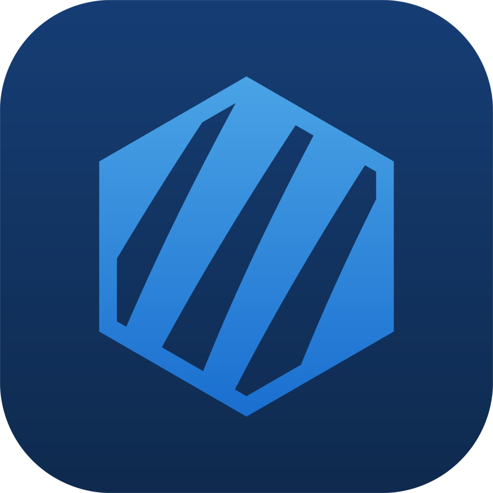
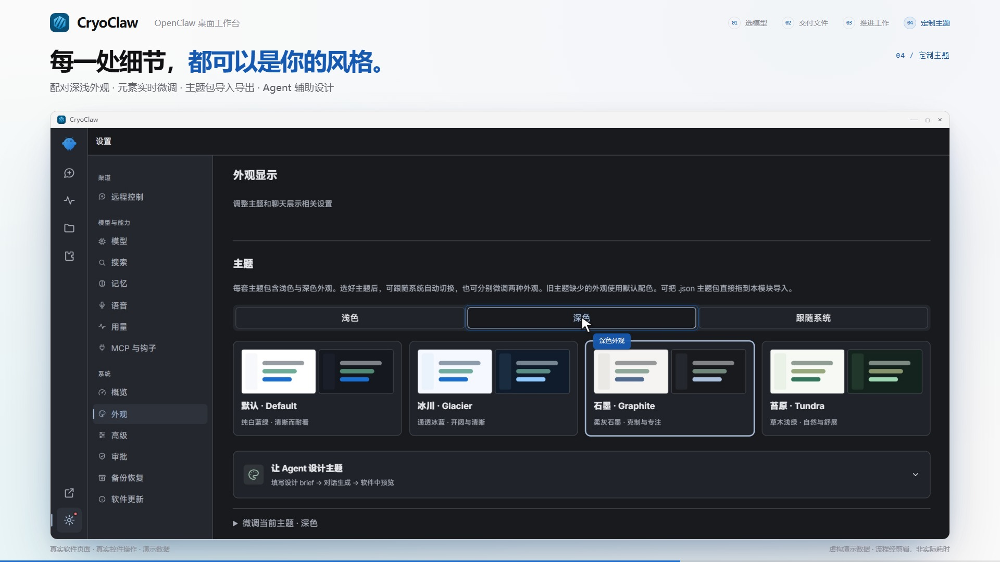

<p align="center">
  
</p>

<h1 align="center">🧊 CryoClaw</h1>

<p align="center">
  <strong>CryoClaw — 从一句话，到一份完成的工作。</strong><br/>
  Your models, browser and files. One <a href="https://github.com/openclaw/openclaw">OpenClaw</a> desktop workspace.<br/>
  安装即有工作台；对话、工作流、插件与看板，在桌面上接着做。内置运行环境，无需另装 Node.js 或 npm。
</p>

<p align="center">
  <a href="https://github.com/binchen6/CryoClaw/releases/latest"></a>
  <a href="https://github.com/binchen6/CryoClaw/blob/main/LICENSE"></a>
</p>

---

> 🌐 [访问官网](https://cryoconite.cn/CryoClaw) · [下载 Windows x64 稳定版](https://github.com/binchen6/CryoClaw/releases/latest) · [观看 58 秒功能演示](website/assets/cryoclaw-demo.mp4) · [分镜与功能依据](docs/promo.md)。官网源码在 [`website/`](website/README.md)，纯静态零构建，不随安装包分发。

## 🇨🇳 中文

> 2026.1025.0：重设计的响应式看板、独立模块预览、元素微调与无闪屏全屏，完善对话草稿恢复和安装更新路径；官网提供 58 秒最新版实机演示。[深度审查与实测](docs/REVIEW-2026.1025.0.md)。

### ✨ 项目简介

CryoClaw 是基于 **[OneClaw](https://github.com/oneclaw/oneclaw)**（AGPL-3.0）重构的 **OpenClaw 桌面工作台**。连接自己的模型，让 AI 从对话走向浏览器操作、文件处理和日常协作。安装包内置运行环境；首次使用仍需连接模型，并按需启用浏览器扩展、技能或消息渠道。

### 五个入口，把工作接起来

| 从哪里开始 | 工作如何往前走 |
|---|---|
| **安装体验：先开始，环境已经备好** | 安装包内置 Node.js 与 OpenClaw，跟随引导接上自己的模型。应用更新、内核升级与配置备份各有入口，少做环境准备。 |
| **对话体验：跟得上你的思路** | 自选模型与思考档位，带上文件开始聊。工具状态、任务计划与执行审批伴随展开；引用、重发、回放与分支，让上下文接得住。 |
| **工作流：从工具，到交付** | WebBridge 衔接浏览器，Office 技能读写文档、表格和演示文件，本地工作区继续编辑。定时任务与消息渠道，让重复工作也有去处。 |
| **插件市场：需要什么，再添什么** | 在图形界面中搜索 ClawHub、安装技能和插件，也能导入本地扩展。已安装能力在同一入口查看、管理。 |
| **看板：把常用信息留在手边** | 先预览模块模板再添加，或让模型制作。右键看板标签编辑标题与说明，让模型参考你的要求；编辑模式支持选择卡片或内部元素微调。 |

<details>
<summary>展开更多能力：模型、主题、文件与协作</summary>

以下能力分别服务于这五条日常路径：

| 卖点 | 你能用它做什么 |
|---|---|
| **1. 安装即有工作台** | 内置 Node.js 与 OpenClaw 运行环境，跟随引导连接模型，无需搭建开发环境。 |
| **2. 多模型，自由切换** | 按服务商分组、搜索和排序模型，调节支持的思考档位；配置 fallback 备用链，应对模型不可用。 |
| **3. 主题，高自由度定制** | 自定义深浅配色、字体字号、字重行高、圆角、间距、阴影与组件样式，实时预览；主题包可导入、导出，也可提交设计要求与参考图，让 Agent 辅助生成主题。 |
| **4. 浏览器接着用** | 启用 WebBridge 扩展后，在常用浏览器中读取网页、点击和填写，衔接已有登录状态。 |
| **5. Office 文件直接处理** | 内置 Word / Excel / PowerPoint 技能与 OfficeCLI，用自然语言驱动文档、表格和演示文件的读写与修改。 |
| **6. 文件就在工作区** | 浏览、搜索和编辑本地文本文件，将文件带入对话；草稿备份、文件标签、Git 差异与 worktree 管理衔接同一项目。 |
| **7. 技能与插件按需扩展** | 在图形界面发现、安装和管理技能与插件，通过 ClawHub 接入更多工具能力。 |
| **8. 熟悉的消息入口** | 配置飞书、企业微信、钉钉、QQ Bot 或微信，在已连接的渠道中与 AI 交互。各渠道按各自流程绑定。 |
| **9. 对话可以回头、分岔** | 从压缩回放点恢复或分支会话，配合消息引用与失败重发，继续探索另一条思路。 |
| **10. 执行权限自己定** | 在逐步询问、智能审批和全部允许之间选择；结合工具状态与计划面板，跟进任务执行。 |
| **11. 升级有退路** | 应用差分更新与内核升级分开管理；内核健康检查失败自动回滚，配置支持备份与恢复。 |
| **12. 看板独立留在手边** | 看板独立于会话，支持模块模板预览与直接添加、标签右键编辑标题和说明、卡片与内部元素选择微调、自由排布与尺寸调整。本地状态会保留，公开数据源可关联定时任务更新同一卡片。 |

</details>

[](website/assets/cryoclaw-demo.mp4)

*58 秒演示，依次展示安装与模型、对话与文件、扩展、模板工作台和元素微调。界面均为最新版实机录制，任务与文件为演示内容；原速片段经剪辑，未调用模型生成修改。流程经剪辑，不代表实际任务耗时。*

这个项目同时是一次 **vibe coding** 实践——全部迭代由人类掌舵需求与验收，通过与多个 AI 编码助手的**多轮协同对话**完成：

| 角色 | 模型 / 工具 | 分工 |
|---|---|---|
| 主力 | **Kimi K3**（Kimi Code）+ **Codex** | 架构重设计、核心功能实现 |
| 协同 | **DeepSeek v4 Flash** | 代码审查、打包与效率优化 |
| 协同 | **Qwen3.8 Max**（Qoder） | 调试取证、测试与文档 |

> 内核来自固定版本的官方 [OpenClaw](https://github.com/openclaw/openclaw) 包，使用独立 Node.js 与物理目录。构建和升级链路维护少量可审查、幂等的兼容与性能补丁；补丁及其验证集中在 `scripts/lib/kernel-dist-patch.js`，不绕过原生资源边界和更新回滚。

### 🆚 与 OneClaw 相比

| 维度 | OneClaw | CryoClaw |
|---|---|---|
| 视觉设计 | 原版主题 | 2026.9 R2 全新设计体系（中性灰 + CryoBlue 蓝青混色强调色、浅色一等 + 暗色配套、design token + cc-* 原语组件、CryoIcons 自绘图标、图标轨应用壳） |
| 更新策略 | 应用自动更新（CDN） | 应用自动更新（GitHub Releases + blockmap 差分下载，设置页可手动检查）+ 独立内核升级、健康检查与回滚 |
| 设置架构 | 主进程自研读写 IPC | 全面切换内核 `config.get`/`config.patch`（乐观锁 + RFC7396 diff），退役 15+ 自研 IPC |
| 流式渲染 | 逐帧全量 markdown | 逐帧纯文本流式 + 终态一次性排版（消除 O(n²) 卡顿），折叠区懒渲染 |
| 运行环境 | — | 安装包内置独立 Node.js 与完整内核目录，按目标平台准备原生依赖；旧 ASAR 路径保留兼容用途 |
| 模型管理 | 基础列表 | provider 分组 + 拖拽排序 + 自定义分组 + fallback 链 + 搜索 + 能力徽标 + 密钥有效性探测 + 选择器联动；ChatGPT/Codex 原生账户与额度同步、独立 HTTP(S) 代理（真实账户验收状态见 docs/CODEX-SUBSCRIPTION-INTEGRATION.md） |
| 思考强度 | 部分模型被误限为开/关二值 | 按模型能力开放全档位（Kimi K3：low/medium/high/xhigh/max），thinkingLevelMap 正确路由 |
| CLI | `openclaw` PATH 注入 | 额外提供 gateway CLI 托管（127.0.0.1 控制面，`openclaw gateway restart/status` 不再报错） |
| 启动体验 | — | 窗口先行与内核并行启动，连接进度可见；V8 编译缓存帮助后续启动。具体耗时见对应版本实测记录 |
| 插件管理 | 命令行 | 顶层「扩展」入口：技能、已安装插件与 **ClawHub 市场**，支持搜索安装、启停、卸载和本地导入 |
| 测试 | — | vitest + node:test + Chat UI typecheck 与单测 + scripts 四层回归；`npm test` 记录每层日志与 JSON 汇总 |
| 代码质量 | — | jscpd 度量全源码重复率，阈值 5%，通过 `npm run dupcheck` 检查 |

### 🚀 快速上手

**方式一：安装包（推荐）**

前往 [Releases 页面](https://github.com/binchen6/CryoClaw/releases/latest) 下载 Windows x64 安装包：

```
1️⃣  双击 CryoClaw-Setup-<版本>-x64.exe 安装
2️⃣  选择服务商，输入 API Key
3️⃣  开始对话！
```

不需要装 Node.js，不需要 `npm`，不需要配置任何环境变量。

**方式二：源码构建**

```bash
# 需要 Node.js >= 22.12
git clone https://github.com/binchen6/CryoClaw.git
cd CryoClaw
npm install
npm run dev          # 开发运行（首次会自动下载并打包 openclaw 内核）
npm test             # 全量测试
npm run dist:win     # 打包 Windows x64 安装包 → out/win32-x64/
```

### 🤖 支持的 AI 提供商

Anthropic (Claude) / OpenAI (GPT / Codex) / Google (Gemini) / Moonshot（Kimi）/ DeepSeek / GLM / Qwen / 小米 MiMo / Ollama 本地模型 / 自定义 OpenAI / Anthropic 兼容接口。支持主模型 + fallback 备用链，自动降级时界面有提示；思考强度按各模型能力开放档位（Kimi K3 支持 low/medium/high/xhigh/max）。模型列表可一键从提供商线上接口同步；DeepSeek / Moonshot / GLM Coding Plan 支持余额与套餐用量查询。

### 💬 多渠道集成

飞书 / 企业微信 / 钉钉 / QQ Bot / 微信 —— 在设置 → 渠道中按各平台流程绑定，在熟悉的消息入口与 AI 交互。

### 🏗️ 技术细节

```
CryoClaw (Electron 43 + TypeScript 5.9)
  ├── 主进程壳        src/          IPC 白名单 + sender guard；gateway 子进程托管
  ├── 内核            openclaw 2026.10.6（版本 pin，独立 Node.js 24.22.1 + 实体目录）
  ├── 聊天界面        chat-ui/      Lit 3 + Vite SPA，file:// 本地加载；图标统一 lucide 风格
  ├── 应用更新器      src/app-updater.ts  electron-updater + GitHub Releases，差分下载、静默换装
  ├── 内核升级器      scripts/updater/  完整目录换装、恢复日志、健康检查与回滚
  └── 打包链路        scripts/package-resources.js → electron-builder
```

- **通信**：chat-ui 经 WebSocket RPC 与 gateway 内核通信（内核注册 483 个 RPC 方法（随内核升级增长））；渲染层 CSP 只允许连接 127.0.0.1。
- **渲染**：markdown 引擎（marked + DOMPurify）支持 GFM 表格/任务列表，样式化的标题与斑马纹表格；代码块带语法高亮（highlight.js 按需加载 15 种常用语言）、语言标签与悬停复制按钮；LaTeX 公式（$$块级$$/$行内$）KaTeX 专业排版；历史消息 `MEDIA:<路径>` 标记渲染为本地图片（点击全屏预览）；LRU 缓存 + 流式旁路防污染，解析异常自动退化为纯文本。
- **消息操作**：任意消息悬停「引用」一键插入 markdown 引用块到输入框；发送失败错误卡片带「重发」按钮，可反复重试。
- **本地文件卡片**：历史消息中的 `MEDIA:<路径>` 标记——图片直接渲染预览，其他常见文件类型（文档/表格/压缩/音视频/代码等）渲染为文件卡片：点击打开、卡片内按钮在文件夹中显示，图标按扩展名区分。
- **子代理等待反馈**：主回合等待子代理期间，聊天区显示子代理状态卡（标题/运行状态/进度摘要），阅读指示器同步切换为「等待子代理返回」。
- **会话回放/分支**：压缩回放点列表（`/compact` 触发），支持回放（rewind）到任意回放点、从回放点分支（fork）出新会话，回放后可直接继续对话。
- **插件管理**：顶层「扩展」入口管理技能与内核插件（启停/卸载），内置 **ClawHub 市场**（搜索、安装），支持本地导入。
- **快捷键**：Ctrl+N 新建对话、Ctrl+L 聚焦输入框。
- **安全**：全部 IPC 通道过 sender guard；API Key 只存本机（`~/.openclaw/openclaw.json`）；日志统一归集到 `~/.openclaw/logs/` 并脱敏；设置 → 高级 可一键导出**诊断包**（日志 + 环境信息 + 脱敏配置摘要）；open-external 仅放行 http(s)。
- **应用更新**：设置 → 关于 页「应用更新」卡片：启动后静默检查 GitHub Releases，blockmap 差分下载，下载完成后一键「重启更新」（NSIS 静默换装）；失败自动回退全量下载并校验 sha512，不弹窗打扰。
- **稳定性**：渲染进程崩溃自动恢复（60s 滑窗熔断）+ 内存软监控；退出时自动清理临时缓存（保留用户配置与会话历史）。
- **内核升级**：设置页「内核升级」卡片或 `openclaw update` CLI，差分换装、双备份、健康检查失败自动回滚。
- **执行权限**：逐步询问 / 智能审批 / 全部允许三态 + Docker 沙箱前置守卫；支持 `update_plan` 计划悬浮面板、目标模式、消息队列、`/` 命令补全。
- **样式体系**：`shared/design-tokens.css`（中性灰 + CryoBlue 混色 brand-500 `#2a89dd`，浅色一等）+ `styles/primitives.css` 契约组件，禁止硬编码颜色。
- **测试**：vitest（主进程单测）+ node:test（编译产物/脚本）+ chat-ui typecheck 与单测 + scripts 用例，`npm test` 一键全量；当次结果与日志在 `.cache/test-results/`，版本验收记录见 `docs/OPTIMIZATION-PROGRESS.md`。
- **代码质量**：`npm run dupcheck`（jscpd，配置 `.jscpd.json`，阈值 5%）度量全源码重复率；公共逻辑集中在渠道面板共享模块、Kimi OAuth 流程、安全打开白名单等共享模块。

详细架构与历史优化记录见 `docs/architecture.md` 与 `docs/OPTIMIZATION-PROGRESS.md`。

### ❓ 常见问题

**Q: 我完全不会编程，可以用吗？**
A: 当然可以！CryoClaw 就是为非技术用户设计的。

**Q: 可以从 OneClaw 迁移过来吗？**
A: 可以。两者共享 `~/.openclaw` 内核数据目录，会话、渠道、凭据无缝继承；OneClaw 的应用配置会在首启时自动迁移。

**Q: Setup 之后可以换 Provider 吗？**
A: 可以。在托盘菜单点「设置」即可修改。

**Q: 应用如何更新？**
A: 双通道：应用本体走 GitHub Releases 自动更新（启动后静默检查，差分下载，设置 → 关于 页可手动检查并「重启更新」）；内核能力演进走内核升级器（可升级、可回滚、有更新日志）。

---

## 🇬🇧 English (Summary)

**CryoClaw** is a fork-and-rebuild of [OneClaw](https://github.com/oneclaw/oneclaw) (AGPL-3.0): an efficient, easy-to-use, pure harness around the [OpenClaw](https://github.com/openclaw/openclaw) kernel. The whole project was iterated via **vibe coding** — multi-round collaborative sessions with Kimi K3 (Kimi Code, lead), DeepSeek v4 Flash (Codex) and Qwen3.8 Max (Qoder), with humans steering requirements and acceptance.

**From a prompt to finished work.** Five everyday paths: install with a bundled runtime; chat with your choice of models, visible tool progress and conversation branches; move from browser research to Office deliverables and local files; add skills and plugins through ClawHub or local imports; and keep notes, tools and public data in independent dashboards. Model accounts, browser permissions and channel setup are required where applicable. [Explore the website](https://cryoconite.cn/CryoClaw) or [watch the 58-second feature and live demo](website/assets/cryoclaw-demo.mp4). All UI clips come from the current Electron build; demo conversations and files are labeled, and no model generation was requested.

Preview module templates and add them directly to a dashboard. Right-click its tab to edit the title and description the model uses as context. In edit mode, select a card or an element inside it for targeted adjustments.

Make it your own with live theme previews, paired light/dark palettes, typography, geometry, component styling, import/export and agent-assisted theme design. Fallback model chains, protected drafts and Git views, five messaging integrations, configurable execution approvals, separate app/kernel updates, configuration backups and kernel rollback help work continue across tasks.

Highlights over OneClaw: a CryoBlue design system with paired themes and CryoIcons; GitHub Releases app updates with blockmap differential download; an independent kernel upgrader with health checks and rollback; kernel-backed `config.get`/`config.patch` settings; streaming plain text with final Markdown formatting; GFM tables, code highlighting and KaTeX; quote and resend actions; conversation rewind and fork; a unified extensions page; a bundled standalone Node runtime and physical kernel directory; model groups, ordering, fallback chains and capability badges; per-model thinking levels; instant /new session reset; managed gateway CLI; early window creation and V8 compile cache; redacted diagnostics; renderer crash recovery; four-layer regression checks; and jscpd duplicate-code checks (`npm run dupcheck`, 5% threshold).

Download from [Releases](https://github.com/binchen6/CryoClaw/releases/latest) (Windows x64 installer), or build from source with Node.js ≥ 22.12 (`npm install && npm run dev`).

---

### 🤝 参与贡献 / Contributing

想参与开发？请先阅读 **[CONTRIBUTING.md](CONTRIBUTING.md)**。
Want to contribute? Please read **[CONTRIBUTING.md](CONTRIBUTING.md)** first.

### 🙏 致谢 / Acknowledgements

- [OpenClaw](https://github.com/openclaw/openclaw) — 本项目封装的 agent 内核。
- [OneClaw](https://github.com/oneclaw/oneclaw) — 本项目的上游代码库；CryoClaw 在其基础上更名、重设计并重构（修改说明见上文「与 OneClaw 相比」）。

### 📄 License

GNU Affero General Public License v3.0 (`AGPL-3.0-only`)，与上游 OneClaw 一致。

Commercial use is allowed, but if you modify and distribute this software, or provide a modified version over a network, you must provide the corresponding source code under AGPL v3.
