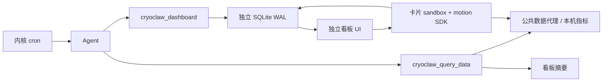

# 2026.1022.0 内核适配、启动与交付体验审查

本记录覆盖 OpenClaw 2026.10.5 阶段的网关生命周期、仪表盘、交付插件与文件卡片，以及用户确认的上下文 A–E 方案。此阶段未单独发版，结果合并进入 [2026.1023.0 / 10.6 审查](REVIEW-2026.1023.0.md)。没有改写用户私人 AGENTS、SOUL、MEMORY 或心跳周期；用户另外的宣传素材改动不属于本次提交。

## 实际故障与修复

| 问题 | 证据与影响 | 修复及边界 |
|---|---|---|
| 数据库门槛仍写死 24 | 10.5 实际要求 agent schema 25；旧版本误判已经完成迁移 | 从实际内核 schema gate 生成与包版本绑定的 compatibility 文件；WAL 存在时读只读快照，避免只看陈旧文件头。失败不盲目执行三轮 doctor |
| ASAR regular-file 返回类型错误 | fs-safe 新契约需要 `{buffer,stat}`，旧补丁只给 Buffer | 恢复返回契约、最大字节数和身份检查；物理解包路径交回原校验 |
| 插件源码模块被上游拆分 | Windows canonical-root 与 native host 补丁没有完整覆盖 artifact/source-lookup | 同时适配两个模块；普通物理路径使用 Windows native realpath，ASAR 和异常保留原回退 |
| 模型准备被配置发布抢占 | 原生 superseded 错误将可恢复的竞态永久降级 | 仅对明确的 publication superseded 重试最多两次，每次仍检查原 authority；普通错误、过期权限和预算耗尽继续失败 |
| 握手早于 agent admission | 一打开应用就出现“操作失败”“进度无法刷新”，后端实际仍在准备 | identity 读取完成后再启动 UI 初始读取；只重试明确的 preparation pending；普通超时和写操作不重放，断连取消旧代次 |
| 多个调用同时 start | 后调用提前返回；停止中仍可生成新子进程 | 复用在途 start promise，保留取消和 generation 检查；主动停止不算崩溃 |
| Windows 停机强杀 | Node/SQLite 无法完成清理，后续重新做完整检查 | 私有父子 IPC 转入原生 SIGTERM；退出事件持久化编译缓存；有界等待与强杀兜底 |
| 编译缓存多了一层启动器 | 壳层提供未限定目录，10.5 启动器重新按 version/build 命名后 respawn；IPC 实际停的是启动器 | 启动前使用与内核一致的 buildId/hash 或 manifest metadata 命名空间；实际进程树已确认只有一层 gateway run |
| 启动期间同步落盘 | 对实际监听网关的 30 秒 CPU 样本中，flushCompileCache 自耗时约 6.4 秒 | 撤掉 15/60/120 秒启动期 flush，改为 180 秒可选持久化与正常退出持久化 |
| 锁文件可能误杀无关进程 | PID 可复用，旧路径没有充分核验 | 验证进程身份和终止结果；不能确认归属则拒绝终止 |

151 MB 的本机 agent 数据库已通过原生 doctor 迁移至 25，并保留迁移前备份。全量 doctor 的首次诊断路径超过常规启动预算，不能将这次升级成本计入普通启动后宣传为 20 秒成功。清理用户数据库、删除历史和关闭现有渠道没有被用作性能优化手段。

## 仪表盘与文件交付

按补充参考图改为全局独立看板，不按会话分类。左轨入口、顶部标签及新建、重命名、归档恢复、浮动编辑/整理/刷新/专注工具栏、拖拽排序与角落缩放、键盘调整、同文档放大/Escape 还原、桌面置顶窗口均已实现。跨看板以 board/card 联合身份挂载 iframe，防止同 ID 卡片串状态；在途目录读取不能覆盖用户正拖动的布局。空看板有模型制作输入区，生成草稿带明确 board ID。内置示例为 17 张蓝/白/黑卡片与章节，包含真实公开汇率、行情、每日走势图、官方发布画廊与时间线、本机体检、待办习惯、截止时间番茄钟、原创 Web Audio 队列和 MDN CC0 视频。示例内容展示来源、数据时间和读取失败，不把抓取时间冒充行情时间，不伪造实时价格或性能值。

模型通过原生 v2 `cryoclaw_dashboard` 发布或按稳定 ID 更新自包含 HTML。全局目录使用独立 SQLite WAL 和有界事务，跨插件实例立即可见；重复操作 ID 复用同一结果，取消前不提交。默认 list 只返回摘要，read_card 才按需读取 HTML。更新保留用户布局和最多 32 KiB/卡的私有本地状态；状态不会进入目录/模型查询。每板最多 24 卡、目录 4 MiB；数据来源最多 4 个/卡，媒体最多 8 个/卡，数据/媒体响应上限分别 512 KiB/32 MiB。自动刷新只访问固定声明的公共 HTTPS 数据源，进行 DNS 验证、连接地址固定、每跳重定向再校验、整体截止、并发/缓存预算控制。在代理把域名解析为 198.18/15 时，独立使用固定 TLS 公共解析端点验证目标，仍拒绝真实私网、凭据 URL 和不受支持的媒体。资料：[AliDNS JSON API](https://static-aliyun-doc.oss-cn-hangzhou.aliyuncs.com/download%2Fpdf%2F171662%2FAPI_Reference_intl_en-US.pdf)、[Frankfurter 每日参考汇率](https://frankfurter.dev/)。

卡片 SDK 的消息以实际 iframe contentWindow 归属和白名单动作路由，限制频率并丢弃过期响应，不能请求任意 RPC。opaque-origin sandbox/no-referrer/CSP 隔离宿主 DOM 与存储，只允许本机能力端点和内联脚本；外部链接需用户手势。桌面窗口没有 preload/Node 权限；写入使用带专用写票据的 CORS simple POST（UTF-8 JSON 文本），避免不透明源的 JSON Content-Type 触发未支持的预检，仍保留 32 KiB 上限、票据范围和取消保护。主面板刷新后可读回置顶窗口保存的状态。签发单卡 write 票据需要 operator.write；普通展示票据不能直接修改状态。布局调整和放大保留运行文档；刷新和导航后由 SDK 恢复状态。先前 CSP 阻断正文的问题保留了真实脚本交互验收。

后续补充按同一架构实现：

- 数据查询独立于面板：`cryoclaw_query_data` 可在普通任务中查询公共 API、本机指标或看板摘要，不需要 board/card ID。默认正文 4,000 字符，上限 16,000，超限显式截断；JSON Pointer 可选择所需子树，返回来源与抓取时间。宿主信息仍对 sandboxed 会话关闭，保留原生工具权限。
- 固定 1600 px 设计画布，窗口收窄时画布与内容一起缩放，保持 12 列和 iframe 原始设计宽度；拖动、缩放手势换算缩放比例，展开使用 1600×900 固定内容面并适配可见区域。占位格保留原布局，放大不挤动其他卡片。实际 1920/800 窗口验证设计宽度相同且无横向溢出。
- 每个模块可使用 CSS、SVG、Web Animations 或 Canvas 动效。示例增加入场、ASCII 漂移、图表描线、悬停和按压反馈、专注计时呼吸及播放状态可视化。SDK 提供 motion.active/reduced/subscribe；IntersectionObserver 和页面可见性事件让离屏 CSS 动画暂停，示例 Canvas 高频循环按可见性和减少动态效果降频。主动播放的音频不因滚动突然停止。取消订阅和卸载清理避免监听残留。
- 定时联动复用内核 cron：稳定 board/card ID 和最多 4 个任务关联随卡片持久保存，更新 HTML 保留状态、布局和关联。卡片任务对话框可创建调度、查看成功/失败/运行/删除状态、立即运行、暂停并解绑、跳转原任务页。新任务先暂停，关联写入后才启用；关联之前失败不会启用；最终启用响应丢失时状态可能未确认，明确提示到任务页核对，不重放写操作。10.5 使用 lastRunStatus，兼容旧 lastStatus。模型任务在正常渠道可发现看板工具；sandboxed 宿主写入继续拒绝。解绑元数据不隐式修改其他调度器的任务，模型按需先暂停或改写原 cron job。示例没有默认付费定时模型调用。

内置插件通过原生 v2 工具工厂注册 `cryoclaw_deliver_files`，schema 只接受 1–12 个本地绝对路径及短标题。检查常规文件、符号链接解析、取消与调用代次，按实际路径去重；不读取或上传文件内容。10.5 静态发现还需要 manifest 的 contracts.tools 与 activation.onStartup，二者都已加入打包门槛。

真实模型调用揭示了 Code Mode 的独立协议：catalog 工具调用持久化为 `role:custom / openclaw.nested-tool.v1`，并非普通 toolResult。UI 现在把原生嵌套回执归一到工具结果路径，保留错误标志与调用身份，让直接调用、Code Mode、流式和历史共享卡片展示规则。仅信任明确的原生 nested-tool 形态和对应工具名，不从任意 exec 文本解析交付协议。

进一步检查实际 `chat.history` 响应发现，公开投影会把嵌套活动变成 toolCall/toolResult 内容块，并移除任意 details。新增最小白名单适配，仅为精确命名的交付工具保留 version 1 回执，限制文件数量、路径、标题与字段、文本预算及 16 KiB 总字节预算；其他工具继续原生过滤。打包核验 core/canvas 两处均覆盖，正常内核换装复用同一补丁。UI 同时支持原始及公开形态；旧内核只能从匹配调用 ID 且明确成功的参数恢复卡片。原生 MEDIA 托管镜像只有在 gateway 自有来源、同组明确 MEDIA 路径及无歧义文件名同时成立时才合并；同名不同路径等不确定情况保留原附件。真实失败载荷离线重放已验证一张插件卡片和一条可合并镜像。

卡片支持文件可用状态、大小、复制路径、另存副本及文件管理器定位。打开实际 realpath 后检查扩展名，符号链接不能用文档后缀伪装可执行文件。原有 MEDIA 文字触发保留；同一助手组内成功的插件回执优先，相同文件只展示一次。其他文件、下一轮、用户附件、待完成和失败工具不受错误抑制。修复 Lit 子节点提交之前绑定元数据、以及卡片内路径被再次转为嵌套链接的问题。

## 缓存与上下文方案执行

数据查询没有面板前置条件；定时任务复用同一工具与卡片身份。模型默认读取摘要，HTML、SDK 指导和 JSON 子树按需展开。卡片刷新、CSS 动效和本地状态变化不会额外调用模型。

- 5 个技能入口合计从 64,365 B 降至 9,715 B，描述从 2,928 字符降至 648。完整指导移入按需 reference，保留生成质量、平台约束、检查和操作路由。数字为 UTF-8 字节/字符，并非 tokenizer token 数，也不代表每轮固定节省 64 KB。五个入口均通过官方 quick_validate。新增仪表盘技能入口 1,210 B、描述 114 字符，六个入口合计 10,925 B/762 描述字符，仍低于 12,000 B/900 字符预算；第六个入口也通过同一校验器。
- 使用内核原有稳定/动态提示词、section/history/tool 指纹及失效机制；不重写用户历史来制造命中，不给所有提供商套统一 retention 或 cache key，不添加付费保温心跳。
- 用量归一化区分原生未缓存 input 与原始 API 总 prompt，提供缓存读取/写入和未缓存输入；缺失与明确 0 分开，错误分母不生成比例。覆盖 DeepSeek、OpenAI、Anthropic 等夹具。
- 只读 `cryoclaw.context.inspect` 在用户展开诊断时扫描内置技能，返回大小、目录指纹、模型和重复 fallback 提示；启动不做额外扫描，不返回私人提示词或凭据。未暴露的服务端失效原因保持未知，不从文件大小推断真实请求命中率。
- 直接模型传输只序列化 content；Code Mode 若 return guest 值，仍可能把路径元数据纳入 exec 返回文本。因此本版保证的是短接口、有限元数据和不读正文，不宣称任何运行模式下都没有元数据 token。

实测第一轮交付的三个 DeepSeek 内部请求，未缓存 input 为 19,020 / 247 / 217，cacheRead 为 1,280 / 20,352 / 20,736，cacheWrite 均为 0。按原生分母加权读取比例约 68.5%。这是一次明确任务的实际观察，后两次约 98.8% / 99.0%，不能保证其他模型、间隔或任务达到相同比例。

## 验证记录

- 四层回归：Vitest 296、node 386、Chat UI 1,225、脚本 231，共 **2,138 pass / 0 fail / 4 平台跳过**，39.1 秒。UI 末轮独立回归 1,225 项再次通过；技能预算与插件存储/网络/独立查询/定时关联专项通过。
- 最终功能矩阵：原生交付回执与 MEDIA 去重、文件大小与操作入口、独立标签、脚本交互、放大/Escape 保留状态、拖拽/缩放持久化、置顶窗口读状态、任务创建/暂停解绑、离屏动效暂停/恢复、宽窄窗设计宽度不变、归档、无页面横向溢出，renderer 异常 0。功能记录：out/feature-review/2026-10-22T12-18-54-209Z/report.json。
- 完整 UI 门禁：**88 场景全部通过**，11 张截图，193.1 秒，复用同一应用实例。覆盖宽窄/明暗/中英、全部设置、DPI、减少动态效果、任务异步归属、确认取消、MCP 展开、上下文诊断和工具卡。记录：同目录 ui-release/report.json。最后的空白横向滚动移除与减少动效专项会纳入末轮安装验收。
- 真实模型制作看板：原生工具发布指定 card ID，带随机标记的内容写入全局目录；实际脚本和 SDK 状态交互由独立 iframe 验证。out/feature-review/2026-10-22T11-20-21-264Z/live-dashboard-report.json。
- 真实模型交付/缓存：两轮用户请求、四次内部模型调用，input=522/153/237/137，cacheRead=19,712/20,352/20,608/20,864，cacheWrite=0；本次加权读取比例约 **98.7%**。嵌套回执进入历史、助手同文件一张卡、用户原附件保留、上下文指纹重复一致。此比例是现有 DeepSeek 短间隔实测，不是其他提供商或新会话的保证。记录：同目录 live-provider-report.json。
- 独立数据查询：普通对话中的真实模型调用 cryoclaw_query_data，未传入看板 ID，返回本机 CPU 指标并持久化最终回复。out/feature-review/2026-10-22T12-06-27-083Z/live-query-report.json。
- 原生 cron 闭环：只强制执行一次已暂停的 QA 调度，模型原位发布同一卡片，HTML 含随机标记，布局完全保留；等待内核 **completedRunStatus=ok** 后才移除任务与关联。out/feature-review/2026-10-22T12-18-54-209Z/live-cron-report.json。没有留下启用的 QA 定时付费调用。
- 实际数据：公共解析回退后，汇率返回 4 对、历史 124 条、官方发布 6 条；行情公开源出现过 socket hang up，卡片保留可见错误与既有值，没有伪造实时数据。外部源可用性不作为价格真实性保证。
- 安装版 app.asar、gateway.asar 与包外 bootstrap 同批校验一致；安装器/清单 SHA-512 与 blockmap 本地一致。远端资产、源码 CI 和正式发布结果在发布完成后补齐。

## 启动实测与剩余边界

20 秒参考目标**没有达到**；用户已明确它不是强制发版门槛。采用同一安装路径、原生配置、正常退出后连续启动，最后三轮为：

| 轮次 | 窗口 | healthz | 完整会话数据 | 首轮启动 / 正常退出 |
|---|---:|---:|---:|---|
| 1 | 1,028 ms | 32,707 ms | 95,212 ms | 成功 / code 0 |
| 2 | 1,025 ms | 38,131 ms | 102,594 ms | 成功 / code 0 |
| 3 | 1,015 ms | 33,779 ms | 94,223 ms | 成功 / code 0 |

预取收敛前，同路径三轮完整数据为 110,959 / 109,807 / 108,737 ms；本轮中位数 95,212 ms，约缩短 13%。这组有限样本只能确认三次首轮启动成功，不能作为总体成功率保证，也不能把 healthz 当成聊天已可用。首次 151 MB 数据库迁移另行记录，不计入正常启动性能宣传。

剩余耗时主要在原生插件/模型 admission、会话和维护链路。没有通过跳过原生校验、删除历史或关闭用户渠道来达标。连续验收中的多次主动 SIGTERM 会触发内核短时频繁停机提示；进程归属和正常退出码已核对。已配置 Tavily 的 autodetect 警告、少量原生插件 source-receipt/retirement 告警尚未被本轮搜索功能闭环覆盖，不宣称所有第三方插件都已验证。UI 启动等待与真实失败分开显示，普通写请求不会为掩盖超时而重放。
